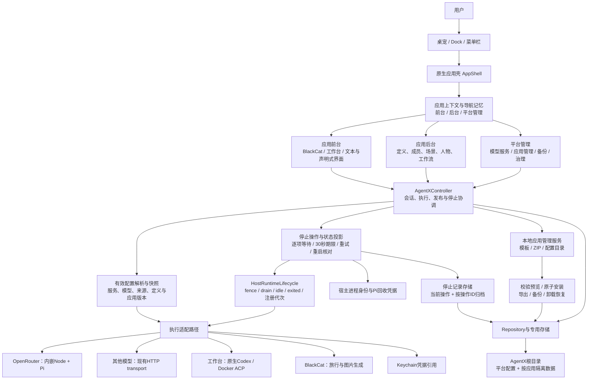
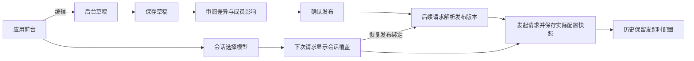
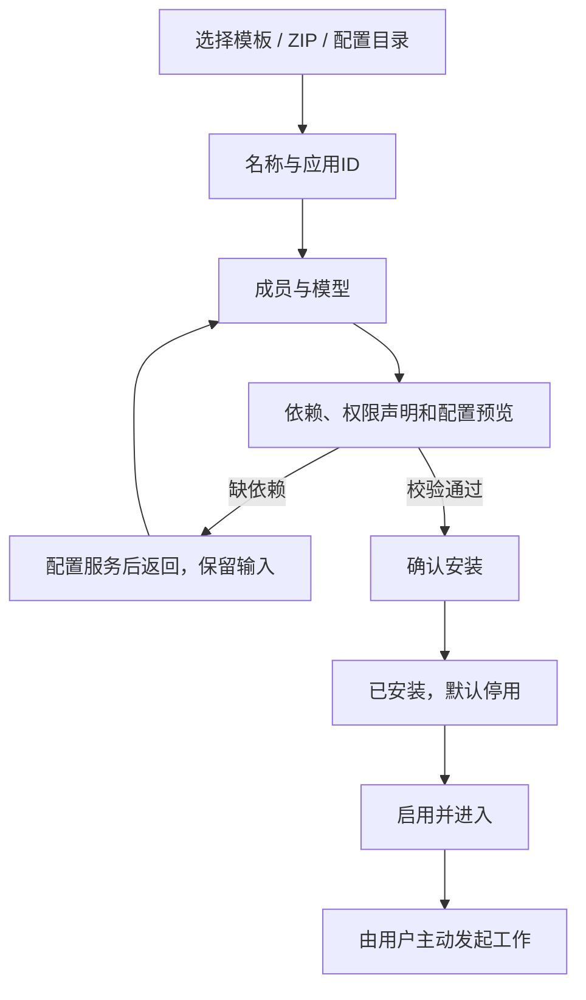
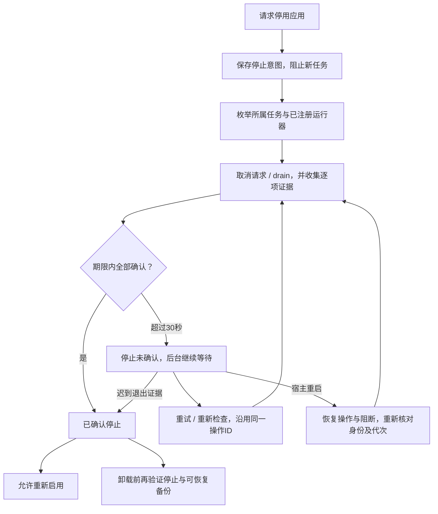
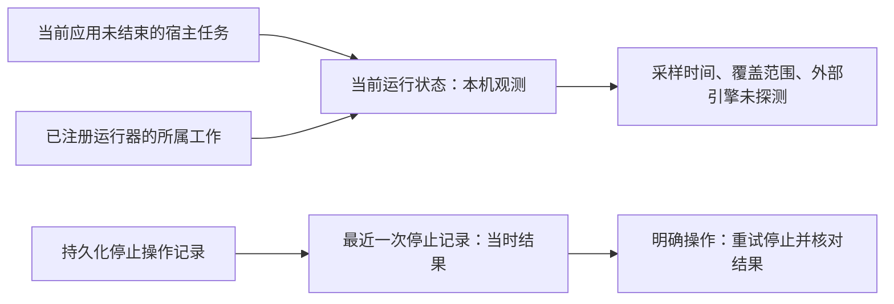
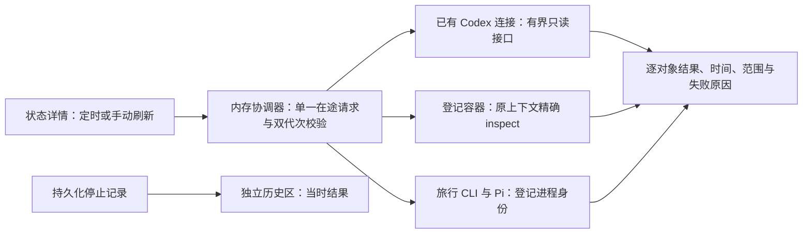

# AgentX build 55：实际架构与交互

> 历史基线：本文保留 build55 及后续阶段记录。当前完整架构与交互请见 [build58 总图与改进方向](agentx-build58-architecture-and-interactions.md)；下文“当前”均按所在阶段理解。

更新日期：2026-11-09。基线：已安装 1.6.0/build 55；本次重新读取正式 Info.plist 确认 build 55。本文描述当前实现，不将设计提案画成已交付能力。历史验收记录原样保留，以本文链接的最新安装结论为准。

## 1. 当前架构



这是逻辑协作图，不表示所有执行器共用一套协议。Controller仍承担较多协调职责；没有独立部署的通用StopCoordinator服务。HostRuntimeLifecycle协调已注册外部运行器，未注册或没有证据的范围保留未知。

| 主要职责 | 当前源码 |
| --- | --- |
| 应用壳与区域导航 | AgentXAppShell.swift、AgentXAppContext.swift、AgentXAppNavigationPolicy.swift |
| 配置来源、实际版本快照 | AgentXEffectiveConfiguration.swift、AgentXConfigurationSummaryView.swift |
| 应用创建与依赖修复 | AgentXAppCreationView.swift、AgentXAppManagementModel.swift |
| 包校验、安装与卸载恢复 | AgentXManagedApplicationService.swift、AgentXApplicationLifecycle.swift、AgentXLocalAppPackage.swift |
| 执行与停止协调 | AgentXController.swift、AgentXHostRuntimeLifecycle.swift、AgentXOwnedTaskScope.swift |
| 停止记录与展示 | AgentXStopOperation.swift、AgentXStopStatusView.swift |

停止记录位于根目录下 manager/stop-operations.json，按操作ID归档于 manager/stop-history。它们是可恢复状态记录，不应称为不可篡改审计日志。模型密钥仍保存在Keychain，不能靠复制应用目录迁移密钥。

## 2. 当前交互结构

```text
┌─────────────────────────────────────────────────────────────┐
│ [应用 ▾ ⌘K] [前台] [后台]  区域/页面   任务详情 搜索 待处理 │
├──────┬──────────────────────────────────────────────────────┤
│应用级│ 前台模块页签 / 后台配置页签                         │
│入口  ├──────────────────────────────────────────────────────┤
│      │ 当前应用内容                                       │
│      │ 对话：成员 + 下次请求模型 + 配置来源摘要            │
│      │ 历史：当次实际配置；旧记录缺失时明确说明            │
│      │ 后台：草稿保存、发布版本、发布影响确认              │
│──────│                                                    │
│应用管│ 平台页显示“平台/页面”，提供返回原应用入口           │
│平台  │                                                    │
│软停止│ 停止按钮仍明确仅覆盖宿主文本运行                    │
│设置  │                                                    │
└──────┴──────────────────────────────────────────────────────┘
```

前后台位置按应用分别记忆；平台往返恢复应用上下文。⌘K切换应用，⌘1–9进入已启用应用，⌘P搜索当前应用。中文组合输入期间，方向键、回车、Esc交还输入法；组合结束后才处理应用导航快捷键。



草稿不会改变普通运行。固定定义版本不自动跟随发布；工作流使用发布绑定，不采用普通会话覆盖。旧运行缺少快照时显示“历史记录未保存配置快照”，不会用当前设置伪造历史。

## 3. 本地应用创建



修改关键输入使旧预览失效；重复预览保留本次来源的成员身份，安装前重新核验来源摘要与依赖。安装不覆盖同ID应用。权限清单只是声明；当前包为受限声明式配置，不支持任意可执行前端或远程Git应用库。

## 4. 应用停用与停止治理



- 30秒是等待期限，不是强杀期限；超时不等于结束。
- 未确认时保持应用停用，阻止重新启用与卸载。重新启用不自动重放任务。
- 已完成结果不会因后到取消被覆盖；旧运行器代次不能确认新执行器已停止。
- 无所属进程凭据的旧Pi任务继续保留未知，不按PID或缺失记录猜测成功。
- 任务详情中的“最近停止记录”是时点证据，不是实时在线监控。正式端无操作记录时显示“未检查”。

## 5. 实际验证范围

| 层级 | 已有证据 | 限制 |
| --- | --- | --- |
| 源码与自动测试 | A/B专项、完整回归及失败修复后的定向测试；包内Pi本机SSE与取消测试 | 完整首轮曾有旧断言/渲染fixture失败，不能写成单次全绿 |
| 原生渲染 | A的960/1280深浅主题16图；B停止详情4图 | 渲染覆盖不等同每种尺寸下完整交互 |
| 隔离原生交互 | 创建安装启用、配置快照、发布v2旧历史v1、IME、30秒停止、重试、卸载阻断、迟到确认、重启恢复 | B使用可控本机替身，不代表远端daemon实机通过 |
| 正式build55 | 签名及安装文件一致、桌宠/前后台/治理入口、原三应用和历史模型保留、重启恢复 | 未发送新付费推理、未对正式应用实施破坏性停止/卸载验收 |
| 数据保护 | 安装阶段7554文件零变化；旧应用备份保留 | 运行验收后2个配置/记录文件字节变化，无新增删除；初始仅hash不能推断全部字段差异 |

正式安装不等于远端发布；本次没有提交或推送。C仍暂缓。

## 6. 后续改进方向（建议，尚未实现）

| 顺序 | 方向 | 可执行的下一步与验收标准 |
| --- | --- | --- |
| P1 | 真实外部运行器验收 | 分别选择Codex、Docker ACP、旅行任务，使用隔离账户/数据验证停止、断连、重启、退出凭据；每条路径独立记录，不共享“全部通过”标签 |
| P1 | 减少无关数据重写 | 核对Repository保存粒度；仅导航变化不重编码历史run。建立保存前后语义差异与字节证据，避免只凭hash解释变化 |
| P2 | 状态可观测性 | 区分最近停止证据与实时探测；若加入探测，展示覆盖范围、时间、失败原因，禁止用enabled或历史成功推导在线 |
| P2 | 协调职责拆分 | 在保留现有竞态测试下，从Controller提取停止协调与会话解析；先固定接口，再逐项迁移，不重写所有执行路径 |
| P2 | 管理信息更易读 | 服务/成员显示名称为主，ID放详情；超时与恢复使用统一状态投影，减少局部error残留 |
| P3 | 应用生态C | 先定义包版本兼容、升级回滚及权限契约，再评估远程库与可执行前端；需单独设计确认 |

建议下一步优先P1真实外部验收与数据保存粒度，两者分别提高停止可信度和升级可核对性。这里仅提出方向，不自动启动外部执行、改动凭据或扩展权限。

## 依据

- [build55正式安装与数据核验](verification-2026-11-09-build55-installation.md)
- [A交互收敛验证](verification-2026-11-09-interaction-convergence.md)
- [B运行治理验证](verification-2026-11-09-runtime-governance.md)
- [A已确认设计](superpowers/specs/2026-11-08-agentx-interaction-convergence-design.md)
- [B已确认设计](superpowers/specs/2026-11-09-agentx-runtime-governance-design.md)


## 2026-11-09 P1 后续进展（工作树，尚未安装）

此节记录 build55 之后的已授权工作，不改变上文正式 build55 的实现基线。

- 已补充真实 Codex daemon/空线程生命周期、真实 Docker ACP 断连恢复与精确清理、真实旅行 CLI 超时回收证据。活跃推理中止与完整旅行生成仍待隔离账户认证，不能视为全部通过。见[外部运行器验收](verification-2026-11-09-external-runners.md)。
- 已优化 Repository：未变化的历史 run 不进入写入事务，保留原字节及修改时间；新增或变更记录继续原事务，损坏历史拒绝覆盖。见[数据保存验收](verification-2026-11-09-history-write-preservation.md)。
- 正式数据前后 7,554 文件零修改、零新增、零删除。正式应用仍为 build55；本次没有重新打包安装，没有提交或推送。


### 隔离认证补验结果

用户完成隔离登录后，原生 Codex 已实际验证成功回复、活跃流式 turn 中断、断连与重启后的历史恢复；严格助手消息回读补证见外部运行器记录。旅行已完成 4 次文字与 1 次图片真实生成，同一明信片 pendingImage→ready、仓库重开回读和 CLI 取消回收通过。详见[认证旅行验收](verification-2026-11-09-authenticated-travel.md)。这是工作树执行路径的验收；正式 build55 未重装，不将一次明信片成功外推整段旅行往返或多轮稳定性。


### build56 正式安装

2026-11-09 已将历史运行记录保存粒度优化安装到正式 **1.6.0/build56**。前后台切换、应用切换和重启后，既有历史 run 字节、修改时间及语义均不变；7,554 个受保护文件内容无变化。上文 build55 图继续保留为实现基线，build56 增量只改变 Repository 的历史保存策略。见[build56 安装验收](verification-2026-11-09-build56-installation.md)。


## build56 后运行状态展示增量（工作树，尚未安装）

当前状态与最近停止记录已分离，保留上文版本基线。当前卡片每 2 秒采样本应用登记的宿主任务和本机运行器所属工作，展示采样时间与范围；外部引擎仍显示“未探测”。历史停止结果不再作为实时状态来源。



P2 状态展示已完成上述本机观测部分；真实外部引擎探测及正式客户端安装交互验收仍是后续项。见[运行状态展示验收](verification-2026-11-09-runtime-status-display.md)。


### build57 正式安装

2026-11-09，运行状态展示增量已安装到正式 1.6.0/build57，完成当前观测与历史空态分区、采样刷新、应用切换、既有会话和重启核验。最终 7,554 个保护文件内容均与安装前一致，历史 run 修改时间也未变。见[build57 安装验收](verification-2026-11-09-build57-installation.md)。上述“尚未安装”为实现阶段的历史记录，以本节为最新安装状态。


## build57 后外部只读探测增量（工作树，尚未安装）

已实现用户确认的外部只读探测：详情打开时每 5 秒刷新，3 秒上限；逐项显示时间、覆盖范围、失败原因及历史成功时间。停止历史不参与当前探测判断。



不启动运行器、不恢复会话、不生成内容；覆盖不足、未连接和超时明确显示，不能外推整个引擎在线。后续可改善大量对象的分批公平覆盖，目前超过读取/原子响应上限时保守显示覆盖不足。见[只读探测验收](verification-2026-11-09-external-runtime-observation.md)。


### build58 正式安装

2026-11-09，外部运行器只读探测已安装到正式 **1.6.0/build58**。完成正式界面的自动/手动刷新、探测时间与范围/原因说明、应用切换及重启恢复验收。现有业务与历史数据保留，唯一配置内容变化是验收选中的当前应用。真实连接下的运行器行为沿用已完成的隔离验收证据。见[build58 安装验收](verification-2026-11-09-build58-installation.md)。此前“尚未安装”保留为阶段记录，以本节为最新安装状态。
