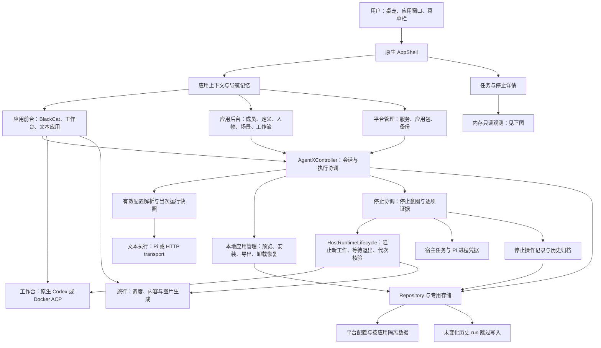
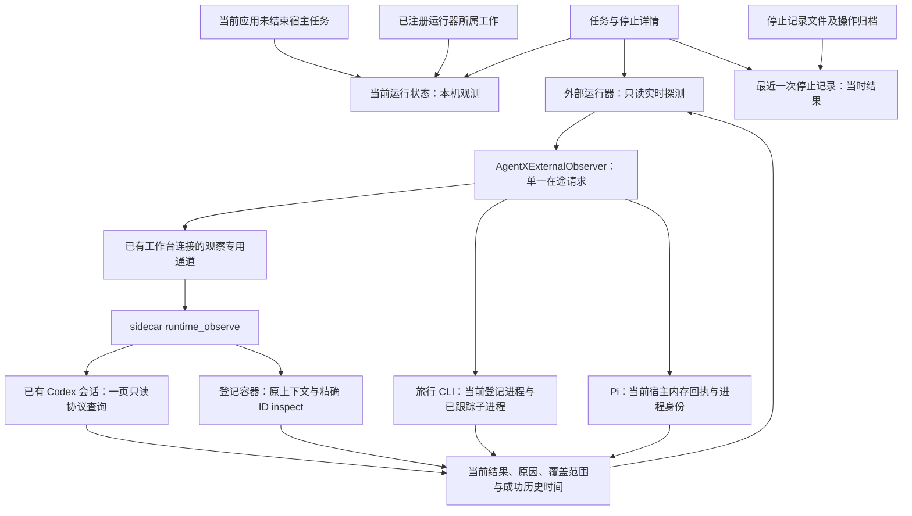
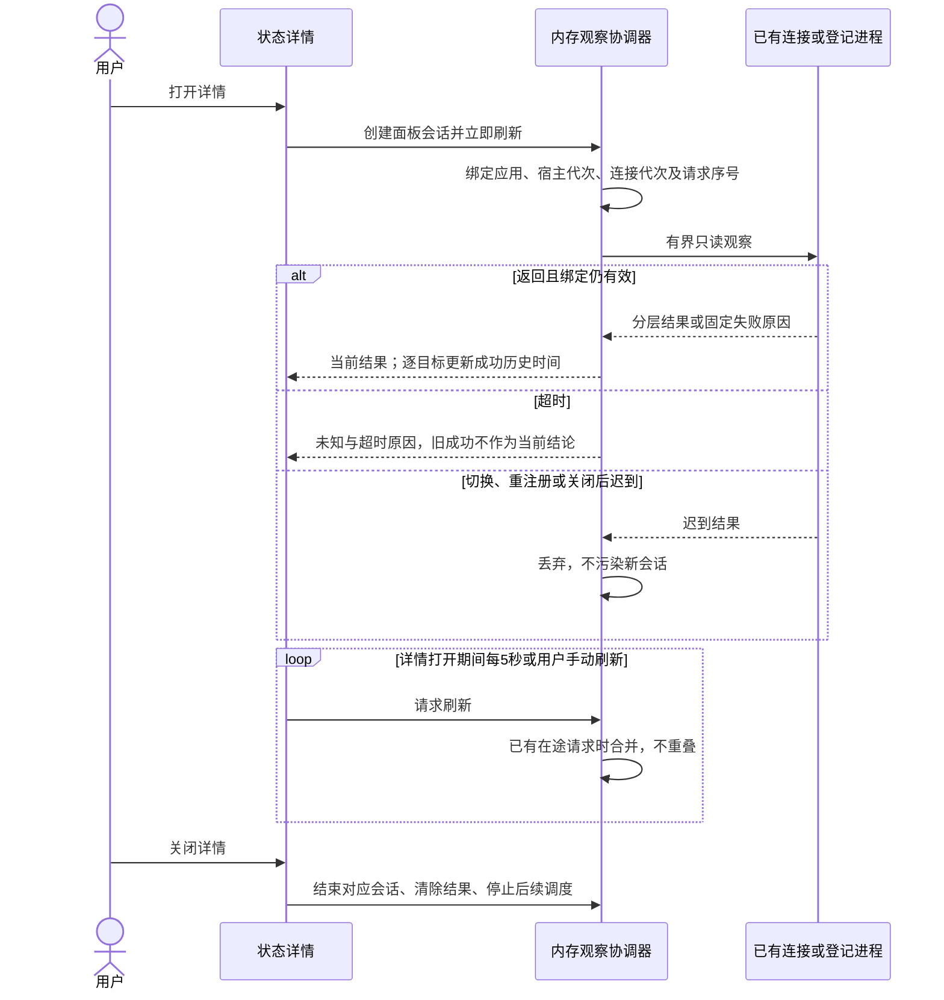

# AgentX build 58：实际架构、交互与后续方向

更新日期：2026-11-09。当前安装基线：**1.6.0/build58**，本次重新读取正式应用 Info.plist 确认。本文整合 build55–58 的已实现能力；建议单独列出，不画成现有功能。本次只更新文档，不改程序或业务数据，不提交或推送。

## 1. 全局架构



图表示职责关系，不表示所有执行器共用一种协议。Controller 仍承担多项协调职责；`AgentXExternalObserver` 是进程内观察协调对象，不是独立监控服务。凭据通过既有 Keychain 引用管理；复制应用数据不等于迁移登录态。

| 版本增量 | build58 中的实际结果 |
| --- | --- |
| build55 | 应用壳与前后台导航、本地声明式应用包、配置快照、停止治理 |
| build56 | 未变化的历史 run 跳过写入；变更记录保留事务与损坏保护 |
| build57 | 当前本机状态与最近停止记录分区，当前卡片每 2 秒采样 |
| build58 | 独立外部只读探测，显示时间、范围、原因及逐目标最近成功时间 |

## 2. 三种状态来源，互不替代



| 区域 | 数据与刷新 | 可以证明什么 | 不能据此推断什么 |
| --- | --- | --- | --- |
| 当前本机状态 | 当前应用任务、已注册运行器；每 2 秒采样 | 本宿主登记的未结束任务和所属工作 | 引擎在线、模型可用、所有进程已退出 |
| 外部只读探测 | 详情打开立即发起，此后每 5 秒调度；可手动刷新 | 本轮实际覆盖对象的响应、存活或退出证据 | 未覆盖对象、全局引擎健康、模型认证与生成能力 |
| 最近停止记录 | `manager/stop-operations.json` 与 `manager/stop-history` | 当次停止操作的逐项结果与时间 | 当前在线状态；重新启用后的实际状态 |

外部结果仅在内存保存。关闭详情会清除该面板结果并停止后续调度，重开重新探测；不会为了取消观察而停止运行器。停止记录是持久化可恢复记录，不是不可篡改审计日志。

## 3. 外部探测的实际覆盖

| 路径 | 已实现的只读动作 | 未探测或失败时的边界 |
| --- | --- | --- |
| 工作台 Codex | 对已有连接任务请求一页 `thread/backgroundTerminals/list` | 不自动启动、重连、恢复会话；有响应只证明此接口可读 |
| 工作台 Docker | 使用登记的不可变容器 ID、原主机或上下文，核对 ID/name 后 inspect | 旧对象缺少可靠身份则未探测；容器不存在/查询失败不能泛化成整个引擎停止 |
| BlackCat 旅行 CLI | 核对当前宿主登记根进程及已跟踪子进程的身份 | 没有当前目标时未探测；不扫描全系统，不验证云端模型服务 |
| 文本应用 Pi | 以应用 run 归属过滤当前宿主缓存的进程回执，核对身份 | 不读取旧会话磁盘账本；历史 run 不要求全部存在当前缓存 |

预算：Swift 轮次/传输上限 3 秒；Python 读取预算 2.2 秒，总分派与投递预算 2.5 秒；每轮最多读取 8 个工作台对象。当前先处理原生对象，再使用剩余额度处理 Docker，尚无轮转公平调度。

响应按系统管道原子写入上限压缩；本机验收为 512 字节。超过容量时按层显示覆盖不足，背压时丢弃完整当轮回复并由客户端显示超时，不发送残缺 JSON。原生读取帧部分发送后超时，尾部留在该连接内存，后续发送先补齐；不启动后台续写或为观察关闭连接。

## 4. 用户交互示意

```text
应用窗口
[应用切换 ⌘K] [前台] [后台]  当前区域  [任务与停止详情] [搜索 ⌘P]
  ├─ 当前应用：对话、历史、成员、制品等
  ├─ 应用后台：草稿 → 差异与影响 → 发布 → 后续请求使用
  └─ 平台管理：配置服务、应用包、备份；返回时恢复应用上下文

任务与停止详情
┌ 当前运行状态 · 本机观测 ──────────────────────────┐
│ 宿主任务数 / 本机所属工作 / 采样时间 / 覆盖说明       │
├ 外部运行器 · 只读实时探测 ─────────── [立即探测] ──┤
│ 开始与完成时间                                      │
│ 每个目标：结果、原因、覆盖范围、最近成功的历史时间     │
│ 进程路径补充本轮核对数量；超时未知，过期明确标记       │
├ 最近一次停止记录 ──────────────────────────────────┤
│ 当时结果；没有记录时显示空态                          │
│ 有记录时显示操作与逐项证据；满足条件才提供重试停止     │
└─────────────────────────────────────────────────────┘
```

此为结构示意，不是另一套界面设计。顶部快捷按钮仍主要显示本机任务/所属工作，完整外部探测结果在详情中；未实现全局常驻在线指示灯。



完成结果超过 15 秒会标为过期。关闭后已有读取可在其预算内结束，迟到结果丢弃；不是通过关闭外部连接来终止探测。

配置交互保持不变：会话选择模型影响下次请求，历史保存发起时配置；旧历史缺快照时明确说明。应用包仍为受限声明式配置，安装默认停用，启用不自动运行。停用治理仍使用独立的阻断、等待、身份核验和恢复路径；“立即探测”不执行“重试停止”。

## 5. 已验收与未外推的范围

| 证据层级 | 已完成 | 明确限制 |
| --- | --- | --- |
| build58 正式安装 | 19 项安装前回归、签名、10,920 文件内容/权限清单一致、包内探测模块与源码一致 | 安装不等于远端发布 |
| build58 正式界面 | 自动/手动刷新、无目标/未连接提示、覆盖说明、应用切换、面板重开、历史模型与重启恢复 | 正式工作台未连接，未在正式数据中制造成功/超时或停止记录 |
| 隔离运行器 | 真实 Codex 只读响应与断连、Docker 运行/停止/移除、CLI 子进程观察 | 没有模型生成请求；不外推服务长期稳定性 |
| 回归与渲染 | 最终 Python 239 项；Swift 相关批次与浅深主题渲染通过，含超时、代次、部分帧、历史混入等 | Swift 各批次存在重叠，不相加成独立总数；不能替代正式交互 |
| 数据保留 | 安装时 7,554 文件零变化；验收后历史 run 字节与修改时间不变 | 验收后 9 文件仅修改时间刷新，current_app 随应用切换改变；不是所有配置零写入 |

正式验收记录发现第一次快捷键退出没有结束旧进程，后用菜单退出、确认进程消失再启动新版本，已完成新版验收。该事实是下文安装流程改进的依据。

## 6. 后续方向（建议，未实施）

优先级按“避免误解与遗漏 → 提高验收可靠性 → 降低维护成本”排序；不是新功能的实施授权。

| 优先级 | 改进方向与现状依据 | 下一步范围 | 验收标准 |
| --- | --- | --- | --- |
| P1-1 | 多对象公平覆盖：原生优先、8 对象上限和响应容量可能让后续对象持续未覆盖 | 分层配额、轮转游标、紧凑分批结果；保留单一在途请求及原子输出 | 隔离环境至少 12 个混合对象，在预定轮数内均被观察；明确本轮/累计覆盖与遗漏，仍无扫描、启动或请求堆积 |
| P1-2 | 状态更易理解：Pi 无当前缓存显示“此范围尚不支持查询”；同类多个对象缺少可读区分 | 区分无当前目标、旧会话未纳入、接口不支持；显示稳定的脱敏目标标签与覆盖数量 | 无目标、旧记录、权限不足、超时各有准确原因；多目标能区分，不暴露凭据或路径，不把未探测变成离线 |
| P1-3 | 升级前退出与新进程身份确认：build58 曾短暂仍运行旧进程 | 安装流程增加旧进程退出检查、未退出时明确阻断、启动后核对新进程与构建身份 | 旧进程未退出时不替换；正常升级验证旧版备份、新进程、文件清单与受保护数据，失败有可核对恢复路径 |
| P2-1 | 打包产物与真实观测闭环：正式验收目前主要覆盖未连接分支 | 在隔离数据中使用实际打包应用接入受控 Codex/容器，验证完整界面到协议链路 | 成功、断连、超时、关闭重开、重启分别留证；正式数据和登录态不改，不为只读验收发起模型生成 |
| P2-2 | 减少其他无关配置写入：历史 run 已优化，安装验收仍有 9 个文件仅刷新修改时间 | 先按路径和触发动作定位，再对未变化配置做必要的写入跳过 | 导航与只读观察不重写无关配置，实际修改仍可靠落盘，损坏文件不被静默覆盖 |
| P2-3 | 拆分协调职责：Controller 仍协调会话、应用生命周期和停止 | 固定接口后小步提取停止协调或会话解析；保持只读观察与停止控制分离 | 现有停止竞态、迟到结果、恢复、数据保护与观察预算测试全部保持通过 |
| P3 | 应用生态扩展 | 先定义版本兼容、权限、升级与回滚契约，再评估远程应用库或可执行前端 | 单独设计确认及隔离验收；当前继续暂缓 |

原先的“减少历史 run 重写”“当前与历史状态分离”“增加只读实时探测”已完成，不再列为待开发功能；真实外部验收已有隔离证据，后续重点是多对象覆盖与打包应用的闭环验收。

## 7. 源码与证据入口

| 职责 | 入口 |
| --- | --- |
| 应用壳/导航 | [AgentXAppShell.swift](../Sources/TravelCatApp/AgentXAppShell.swift)、[AgentXAppNavigationPolicy.swift](../Sources/TravelCatApp/AgentXAppNavigationPolicy.swift) |
| 本机状态/详情 | [AgentXCurrentRuntimeSnapshot.swift](../Sources/TravelCatApp/AgentXCurrentRuntimeSnapshot.swift)、[AgentXStopStatusView.swift](../Sources/TravelCatApp/AgentXStopStatusView.swift) |
| 外部观察模型/界面 | [AgentXExternalObserver.swift](../Sources/TravelCatApp/AgentXExternalObserver.swift)、[AgentXExternalProbeView.swift](../Sources/TravelCatApp/AgentXExternalProbeView.swift) |
| 路由/连接/只读端点 | [TravelCatApp.swift](../Sources/TravelCatApp/TravelCatApp.swift)、[AgentSidecarClient.swift](../Sources/TravelCatApp/AgentSidecarClient.swift)、[runtime_observe.py](../Sources/TravelCatApp/Resources/AgentRuntime/runtime_observe.py) |
| 进程/持久化 | [AgentXOwnedProcessSnapshot.swift](../Sources/TravelCatApp/AgentXOwnedProcessSnapshot.swift)、[AgentXPiProcessLedger.swift](../Sources/TravelCatApp/AgentXPiProcessLedger.swift)、[AgentXRepository.swift](../Sources/TravelCatApp/AgentXRepository.swift) |
| 停止治理 | [AgentXHostRuntimeLifecycle.swift](../Sources/TravelCatApp/AgentXHostRuntimeLifecycle.swift)、[AgentXStopOperation.swift](../Sources/TravelCatApp/AgentXStopOperation.swift) |

- [build58 正式安装验收](verification-2026-11-09-build58-installation.md)
- [外部只读探测：实现、隔离验收与边界](verification-2026-11-09-external-runtime-observation.md)
- [build57 状态分区安装验收](verification-2026-11-09-build57-installation.md)
- [build56 历史写入优化安装验收](verification-2026-11-09-build56-installation.md)
- [build55 历史架构基线与演进记录](agentx-build55-architecture-and-interactions.md)
